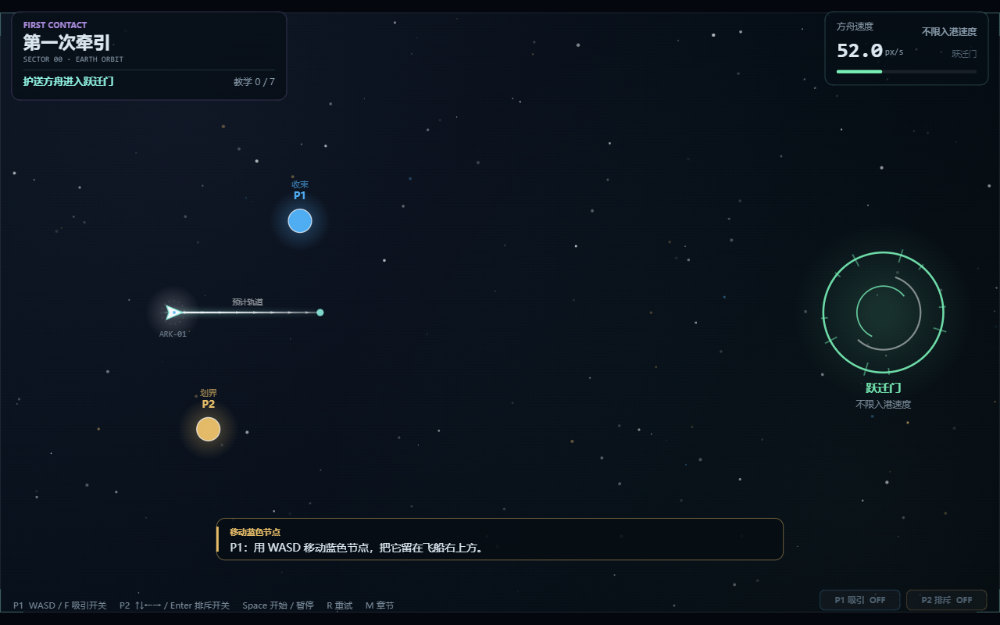

# THE LAST ARK（最后的方舟）

双人同屏、二维引力护航游戏。两名玩家不能驾驶方舟，只能改变它周围的引力，护送人类最后的方舟绕过危险、低速进入空间港。

> **当前状态（2026-10-18）：可运行的垂直切片。**
> 四关已实现并通过无头自动护航验证；TypeScript 类型检查、生产构建、33 个自动测试通过。
> 已在 Edge headless 中实际渲染并截图，console 无错误。
> **尚未验证**：真人双人同键盘手感、硬件按键冲突、低端机性能。



---

## 快速开始

```bash
npm install
npm run dev      # http://localhost:5173
```

其他命令：

```bash
npm run build      # tsc --noEmit + vite build
npm run preview    # 预览生产构建
npm test           # vitest run（33 tests）
npm run typecheck  # tsc --noEmit
```

直达某一关（便于演示 / 联调）：

```text
http://localhost:5173/?level=moving-world
http://localhost:5173/?level=solar-exodus
http://localhost:5173/?level=beyond-horizon
```

### 单文件试玩

`docs/playable.html` 是内联了全部 JS/CSS 的单文件版本（约 57 KB），不依赖开发服务器：

- 直接双击打开，或用任意静态文件服务器托管；
- 嵌入 iframe / 网页时，先点击画面获取键盘焦点，再按 `Space`；
- 重新生成：`npm run build:artifact`。

---

## 操作

| 玩家 | 移动 | 力场（按一次切换） |
| --- | --- | --- |
| P1 · 收束 | `WASD` | `F` 吸引开 / 关（蓝） |
| P2 · 划界 | `↑↓←→` | `Enter` 排斥开 / 关（金） |

- 力场按一次开启，再按一次关闭；不需要一直按住。
- `Space`：开始 / 暂停 / 继续；在通关卡上进入下一章。
- `R`：从本章开头重试。
- `M` / `Esc`：打开章节目录，↑↓ 选择、Enter 进入任意关卡。
- 运行中显示方舟的**预计轨道线**：白色虚线是预计航迹，红色端点表示预计撞击/吞没/越界，绿色端点表示预计入港。
- 失焦或切到后台会自动暂停并清空按键，返回后按 `Space` 继续。

**引力是对话，不是命令。** 吸引让方舟靠近，排斥为它留出距离；两人可以同时施力，矢量叠加。

---

## 四关

| # | ID | 章节 | 目标 | 核心机制 |
| --- | --- | --- | --- | --- |
| 0a | `first-contact` | 第一次牵引 / FIRST CONTACT | 进入跃迁门，不限速 | 移动、吸引、排斥、双场叠加 |
| 0b | `moving-world` | 会动的世界 / THE MOVING WORLD | 避开行星，≤ 48 进港 | 行星也会被力场推动；减速入港 |
| 1 | `solar-exodus` | 逃离太阳系 / SOLAR EXODUS | 4/4 共振 + ≤ 60 进门 | 太阳引力、日冕、冲击波、门锁 |
| 2 | `beyond-horizon` | 越过银河 / BEYOND THE HORIZON | 绕开视界，≤ 65 进出口 | 不可推动黑洞、伽马喷流、潮汐走廊 |

第 3 段「群星之间」是无限模式设计稿，尚未实现，详见 [关卡设计](docs/LEVEL_DESIGN.md)。

---

## 玩法底板

- **固定步长**：物理固定 `1/60 s`；浏览器帧率只影响渲染。
- **软化力场**：`a = s · strength · d / (r² + ε²)^(3/2) · max(0, 1 − r/R)²`，每个源限幅 → 合向量乘 `motionResponse` → 总加速度限幅。
- **同步积分**：同一时刻的所有天体状态先算加速度，再统一半隐式欧拉积分；速度限幅。
- **扫掠碰撞**：方舟与危险天体使用相对运动扫掠圆，避免高速穿透；黑洞按 `consumeRadius` 中心距离吞噬。
- **入港**：方舟完整碰撞圆在港内且速度 ≤ `maxEntrySpeed` 才获胜；完整入港但超速只警告，可港内减速。
- **失败优先级**：`consumed > collision > out-of-bounds`；任何失败优先于胜利。
- **任务层**：`LevelSpec.mission` 是可选纯数据，由 `src/game/mission.ts` 解释（教学、行星、太阳冲击波、黑洞喷流），不改变物理契约。

---

## 已验证

### 自动测试

```text
Test Files  3 passed (3)
Tests       29 passed (29)
```

包括：

- 力场方向、范围外为零、零距离安全、每源限幅、斜向归一化；
- 扫掠碰撞、完整圆入港、边界判定；
- 重试 / 读关的状态与 `runId`；
- 四关零输入基线 + 自动护航通关 + 输入回放一致性。

### 关卡基线（来自 `tests/levels.test.ts`）

| 关卡 | 零输入结果 | 自动护航结果 | 入港速度 |
| --- | --- | --- | --- |
| `first-contact` | **won** 21.0 s | won 21.0 s（零输入） | 40.0 |
| `moving-world` | lost / collision 6.4 s | **won 13.2 s** | 47.7 |
| `solar-exodus` | lost / collision 8.7 s | **won 24.4 s** | 35.4 |
| `beyond-horizon` | lost / consumed 7.8 s | **won 13.1 s** | 64.7 |

教学关零输入即可漂入跃迁门，是设计预期；其余三关零输入都会失败。

自动护航使用**闭环控制器**逐 tick 生成合法输入；测试把这些输入从干净运行时重放，四关都在相同 tick 复现 `won`。证明通关没有直接改位置、速度或阶段。

### 浏览器

- 使用 Edge headless + Playwright，`1280 × 800`，依次检查了四关的准备画面、运行画面、力场、喷流、行星链与门锁；冲击波判定由自动测试覆盖。
- 实际操作验证了：力场按一次开启后持续生效、再按一次关闭；预计轨道线随力场弯曲；`M` 打开章节目录并可用 ↑↓ + Enter 切换关卡。
- 单文件版 `docs/playable.html` 也在同一浏览器中验证：点击画面后 `Space` 可以开始，console 无错误。
- 页面无 console / page error。
- 截图保存在 `docs/screenshots/`。

### 尚未验证

- 两名真人在同一键盘上的手感与硬件 ghosting；
- 提示在真实游玩中的节奏与遮挡；
- 低端机、DPR 2、窄窗口下的性能；
- 移动端（无触摸操作，只显示“建议横向全屏游玩”）。

---

## 项目结构

```text
src/
  shared/contracts.ts       共享契约 v0.2.0
  physics/                  向量、力场、扫掠碰撞
  game/
    runtime.ts              固定步进运行时、状态机、事件
    mission.ts              教学 / 行星 / 太阳 / 黑洞任务脚本
    validate.ts             关卡配置校验
  levels/                   四关纯数据 + campaign 顺序
  input/                    键盘适配（code、力场开关/边沿命令）
  render/                   Canvas 2D 基础渲染器
    cinematic/              视觉 agent 的并行模块（暂未接入主渲染器）
  main.ts                   RAF、固定步长累计器、组合入口
  style.css
tests/                      物理、关卡、回放测试
docs/                       设计、协议、截图
```

> 视觉层与物理层通过 `FrameSnapshot` / `RenderFrame` 解耦。替换 `src/render/index.ts` 不会改变模拟与胜负判定。

---

## 共享契约 v0.2.0

v0.2 是对 v0.1 的**可选、向后兼容扩展**，所有 v0.1 字段保持原义：

- `LevelSpec.mission?`：教学 / 行星 / 太阳 / 黑洞任务脚本数据；
- `FrameSnapshot.mission?`：HUD 任务状态（目标、进度、倒计时、共振链、喷流）；
- `RenderFrame.level?` / `RenderFrame.campaign?`：静态关卡几何与章节信息；
- `NarrativeSpec.chapter?` / `sector?`；`NarrativeHint.voice?` / `title?`；
- `DockSpec.kind?` / `label?`：泊位 / 跃迁门 / 门。

详见 [共享契约](src/shared/contracts.ts) 与 [三 agent 协议](docs/AGENT_PROTOCOL.md)。

---

## 文档

- [单文件试玩](docs/playable.html)：内联 JS/CSS，可直接打开或托管。
- [游戏设计（细化版）](docs/GAME_DESIGN.md)：世界观、速度预算、摄像机、场景状态机、评分与合作场景设计。
- [关卡设计与数值](docs/LEVEL_DESIGN.md)：逐关地图、对象、路线、调参、验收。
- [剧情线（实现版）](docs/CAMPAIGN_STORY.md)：开场卡、提示、失败/通关文案、触发映射。
- [完整剧情与 UI 设定](STORY_AND_UI_DESIGN.md)：世界观、四段旅程、Boss、无限模式。
- [三 agent 协议](docs/AGENT_PROTOCOL.md)：所有权、数据流、物理与输入语义。
- [四小时计划](docs/FOUR_HOUR_PLAN.md)：并行开发节奏与降级规则。
- [引擎说明](docs/ENGINE_BRIEF.md) / [渲染说明](docs/RENDER_BRIEF.md) / [策划说明](docs/DESIGN_BRIEF.md)：早期分工文档，部分已被当前实现扩展。

---

## 已知问题与下一步

1. **真人试玩**：先验证 WASD + F 与方向键 + Enter 同时按下的手感与键盘冲突。
2. **容错回放**：对关键施力时刻做 ±12 tick 偏移，确认关卡不是只靠单帧精确操作。
3. **检查点**：第 1、2 关失败后从最近行星/走廊入口重试，减少重复前戏。
4. **九道共振多屏版**：当前单屏切片压缩为四道主共振；完整九道需要分段加载或镜头跟随。
5. **无限模式**：最后实现，必须复用现有物理与发现卡协议。

---

## License

MIT，见 [LICENSE](LICENSE)。项目不包含外部美术、音乐或字体资源；所有画面均由 Canvas 2D 程序绘制。
